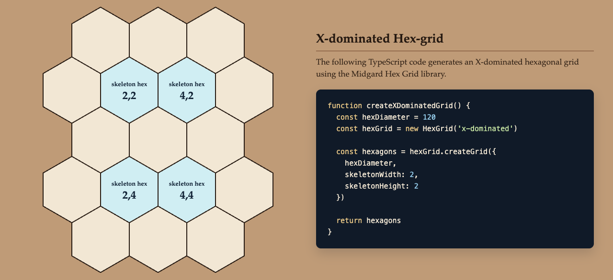
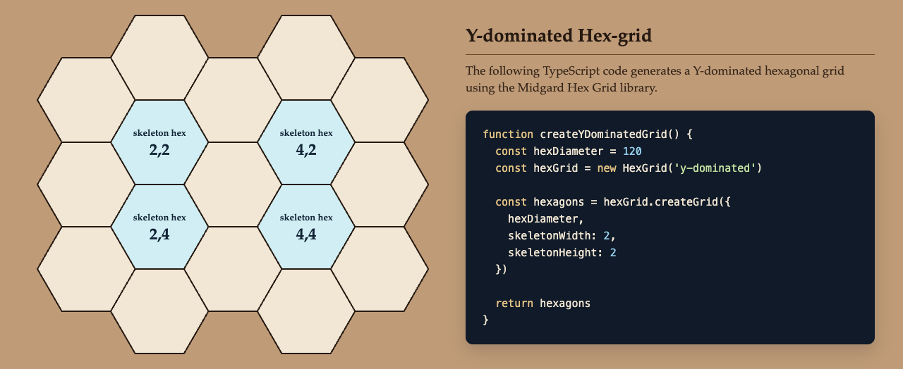
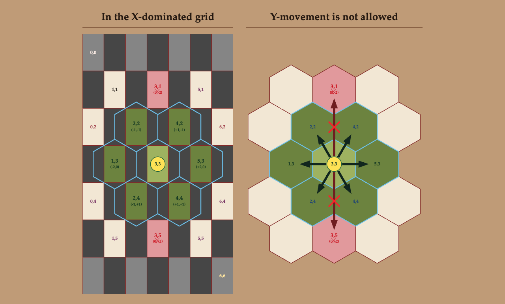
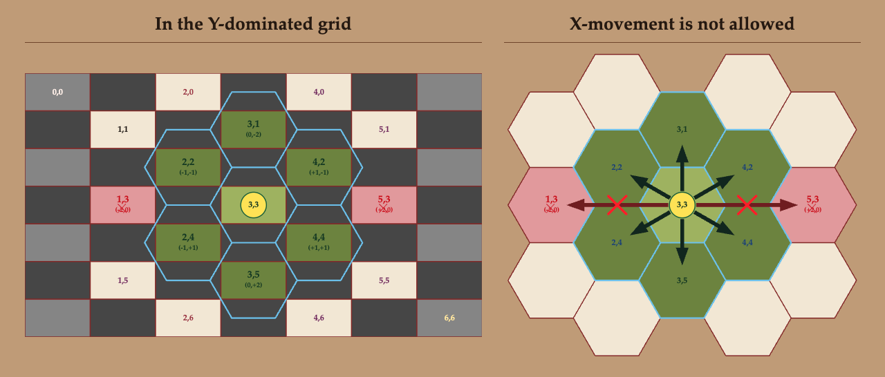

# Midgard Hex Grid

Midgard Hex Grid is a small reusable TypeScript library for creating and working with hexagonal grids.

The library supports both x-dominated and y-dominated hex grids and handles the coordinate system, neighbour calculations, positioning and hexagon geometry. Its purpose is to let another programmer work with hexagonal grids without having to implement these calculations themselves.

## Features

- Create x-dominated and y-dominated hex grids
- Create a single hexagon
- Generate complete grids from a rectangular skeleton
- Calculate the six neighbours of a coordinate
- Validate Midgard coordinates
- Calculate center positions
- Calculate the six corner points of a hexagon
- Calculate the outer bounds of a grid
- Generate coordinate ranges
- Generate layered coordinates with z-index values for rendering

## Requirements

- TypeScript
- JavaScript environment with ES modules

The library has no runtime dependencies.

Development uses:

- TypeScript 7
- Vitest 5

## Installation

Clone the repository and install the development dependencies:

```bash
npm install
```

Build the library:

```bash
npm run build
```

The compiled JavaScript and TypeScript declarations are generated in the `dist` directory.

## Basic usage

The main class is `HexGrid`.

Create a grid by first choosing its orientation:

```ts
import { HexGrid } from './dist/index.js'

const grid = new HexGrid('x-dominated')
```

The orientation can be:

```ts
'x-dominated'
```

or:

```ts
'y-dominated'
```

### Create a single hexagon

```ts
const grid = new HexGrid('x-dominated')

const hexagon = grid.createSingleHexagon({
  hexDiameter: 100
})
```

The returned hexagon contains:

- its Midgard coordinate
- its center position
- its six corner points

These values can, for example, be used by an application to render the hexagon as SVG.

### Create a complete grid

```ts
const grid = new HexGrid('x-dominated')

const hexagons = grid.createGrid({
  hexDiameter: 100,
  skeletonWidth: 3,
  skeletonHeight: 2
})
```

`skeletonWidth` and `skeletonHeight` describe the rectangular skeleton around which the complete grid is generated.

The library automatically fills the surrounding coordinates and returns the hexagons in rendering order with calculated z-index values.

### Y-dominated grid

The same API can be used for the other orientation:

```ts
const grid = new HexGrid('y-dominated')

const hexagons = grid.createGrid({
  hexDiameter: 100,
  skeletonWidth: 3,
  skeletonHeight: 2
})
```

The grid orientation controls the coordinate relationships, positioning and geometry internally.

## Neighbours

The six neighbouring coordinates can be calculated through the grid:

```ts
const neighbours = grid.getNeighbours({
  x: 2,
  y: 2
})
```

The result depends on whether the `HexGrid` is x-dominated or y-dominated.

## Coordinate validation

A coordinate can be checked before it is used:

```ts
const valid = grid.isValidCoordinate({
  x: 2,
  y: 2
})
```

## Lower-level API

`HexGrid` provides the simplest interface for most uses.

The library also exports lower-level classes for programmers who want to work directly with individual parts of the grid system, including:

- `CoordinateValidator`
- `NeighbourCalculator`
- `HexagonGeometry`
- `CoordinatePositioner`
- `CoordinateRange`
- `CoordinateRangeFiller`
- `CoordinateLayer`

The public TypeScript types are exported from `src/index.ts`.

## Testing

The mathematical and coordinate logic is tested with automated unit tests using Vitest.

Run all automated tests with:

```bash
npx vitest run
```

The library is also tested visually with a separate graphical Test-App. This makes it possible to verify that the calculated coordinates and geometry produce the expected SVG hexagons and grid layouts.

See [`TEST_REPORT.md`](./TEST_REPORT.md) for the test documentation and results.

## Development commands

Check the TypeScript code without producing build files:

```bash
npm run check
```

Build the library:

```bash
npm run build
```

Run the automated tests:

```bash
npx vitest run
```

## Version

Current version: `1.0.0`

The version is also available from the library:

```ts
import { MIDGARD_HEX_GRID_VERSION } from './dist/index.js'
```

## License

ISC

## Visual Demonstrations

Midgard Hex Grid includes two complementary demonstrations.

The Minimal Demonstration shows how little TypeScript is needed to create a grid. The Theory Demonstration explains the coordinate system: parity, the skeleton, and the two orientations.

### Minimal Demonstration

A grid is created with `new HexGrid()` and `createGrid()`. Each example below sets `hexDiameter` to 120 and uses `skeletonWidth: 2` and `skeletonHeight: 2`. For an X-dominated grid, `hexDiameter` is the hexagon's width. For a Y-dominated grid, it is the hexagon's height.

`createGrid()` builds the complete grid around the skeleton and fills in the surrounding hexagons. These examples produce 17 hexagons. The four light coastal-blue hexagons are the skeleton, at (2,2), (4,2), (2,4), and (4,4). The cream hexagons are the surrounding fill. Both orientations use the same logical coordinates. Only the geometry changes.

**X-dominated Hex Grid**



**Y-dominated Hex Grid**



The functions below are the examples used by the Minimal Demonstration. Import `HexGrid` as shown in [Basic usage](#basic-usage).

```ts
import { HexGrid } from './dist/index.js'

function createXDominatedGrid() {
  const hexDiameter = 120
  const hexGrid = new HexGrid('x-dominated')

  const hexagons = hexGrid.createGrid({
    hexDiameter,
    skeletonWidth: 2,
    skeletonHeight: 2
  })

  return hexagons
}
```

```ts
import { HexGrid } from './dist/index.js'

function createYDominatedGrid() {
  const hexDiameter = 120
  const hexGrid = new HexGrid('y-dominated')

  const hexagons = hexGrid.createGrid({
    hexDiameter,
    skeletonWidth: 2,
    skeletonHeight: 2
  })

  return hexagons
}
```

### Theory Demonstration

The diagrams below show how a rectangular coordinate field becomes a hexagonal grid, and which movements are valid.

#### Coordinate parity

A valid Midgard coordinate is two even numbers, such as (2,2) or (4,4), or two odd numbers, such as (3,3) or (1,5). A mixed coordinate, such as (3,4), is invalid because its numbers have different parity.

#### The skeleton foundation

(2,2) is always the top-left skeleton hexagon. Every skeleton begins there, whatever the grid's size or orientation. A 1 × 1 skeleton contains only (2,2) as its skeleton hexagon. Increasing `skeletonWidth` or `skeletonHeight` extends the skeleton from that origin through further even coordinates, such as (4,2), (2,4), and (4,4).

#### Grid orientation

An X-dominated grid uses hexagons with pointed tops and bottoms. A Y-dominated grid uses hexagons with flat tops and bottoms. Both orientations follow the same parity rules, so a coordinate such as (2,2) keeps its logical identity when the geometry changes.

**X-dominated — Coordinate System and Neighbour Movement**



The left figure maps the rectangular coordinates onto the hexagons. The right figure shows the six valid neighbours of the center hexagon and marks movement in the Y direction as forbidden.

**Y-dominated — Coordinate System and Neighbour Movement**



The same relationship holds for the Y-dominated orientation. The forbidden movements are in the X direction.

### Explore the Demonstrations

The rendered pages are not published at a separate public address. The source of each page is in this repository:

- [Minimal Demonstration](demo/minimal.html)
- [Theory Demonstration](demo/index.html)

To run them locally, install the demo dependencies and start Vite from the `demo` directory. The `dev` script in `demo/package.json` runs `vite`.

```bash
cd demo
npm install
npm run dev
```

Vite prints a local address. The Theory Demonstration is `demo/index.html`, served at `/`. The Minimal Demonstration is `demo/minimal.html`.
